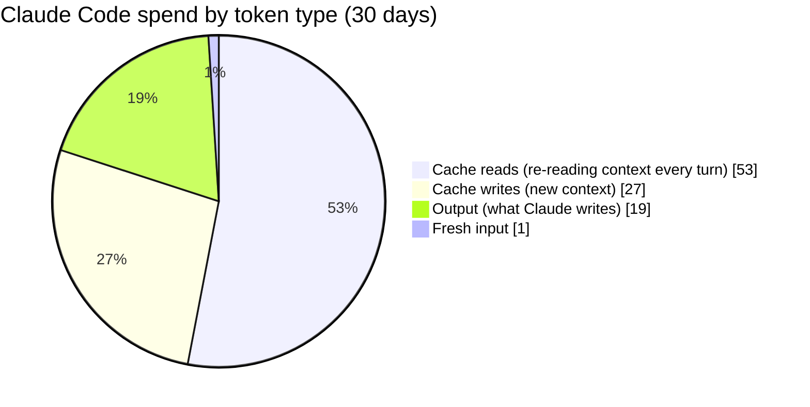
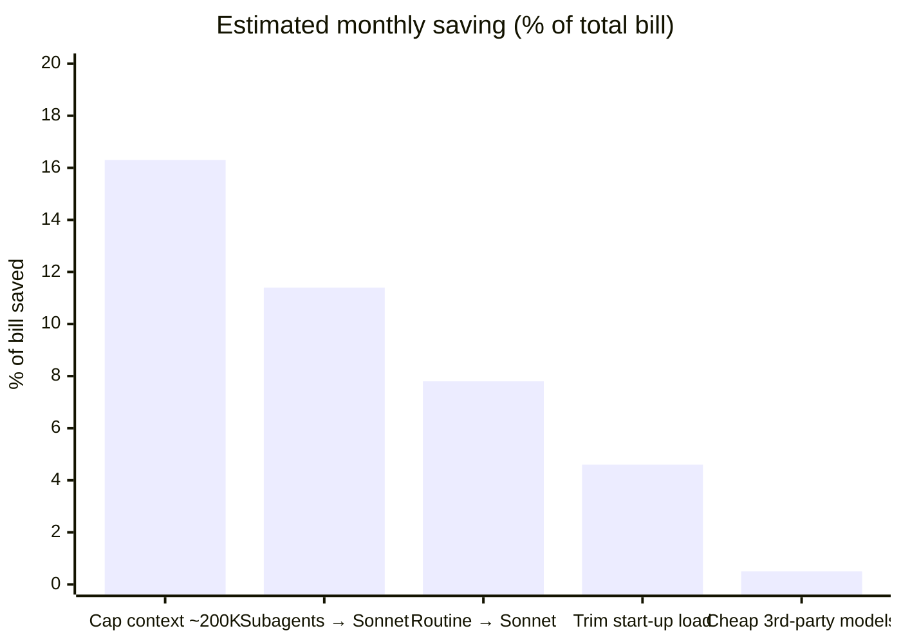
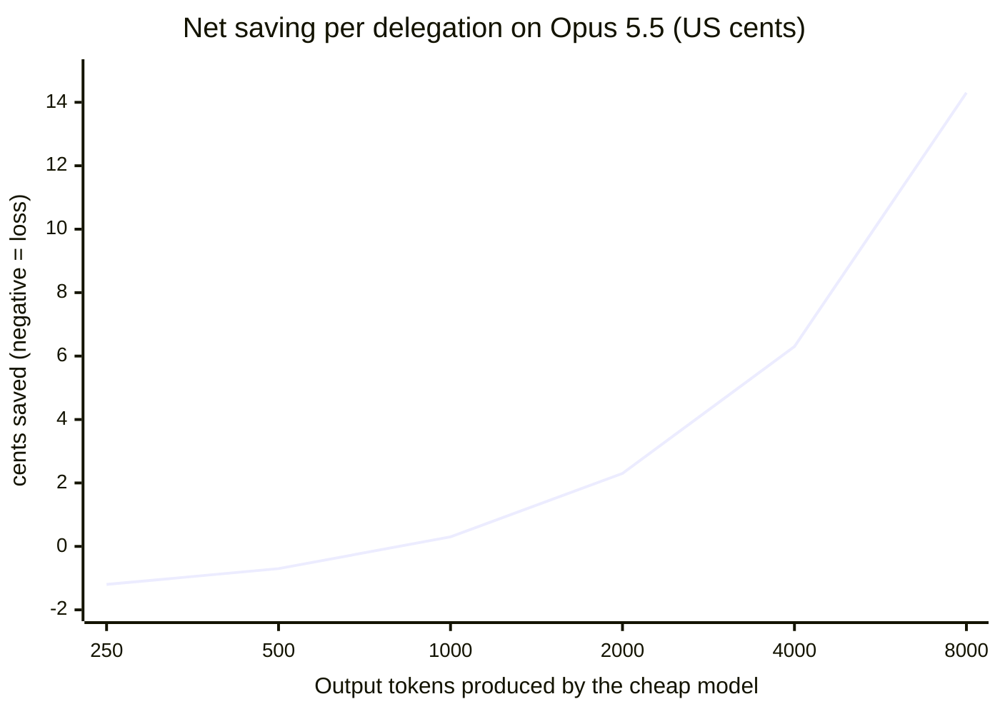
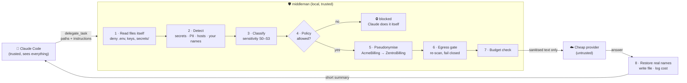
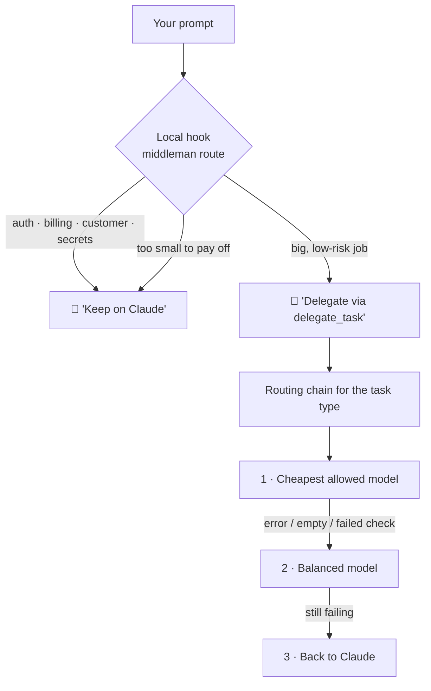

<div align="center">

# 🛡️ middleman

**Spend less on Claude Code, without handing your code to models you don't trust.**

A local Rust tool that sits between Claude Code and cheap LLM providers.
It measures where your tokens go, tells you which settings to change, and when it hands
work to cheap untrusted models it **strips secrets and swaps out your company's identifiers first**.

`Rust` · `MCP server` · `no data leaves without passing the egress gate` · `98 tests`

</div>

---

## TL;DR

| You want to… | Run |
|---|---|
| See where your Claude Code money goes | `middleman usage --since 30d` |
| Get concrete settings that cut the bill | `middleman tune` |
| Hand big, low-risk jobs (tests, boilerplate, docs) to cheap models safely | `delegate_task` via MCP |
| See what was delegated, to which model, and what it saved | `middleman report` |
| Check that everything is wired up | `middleman doctor` |

---

## 💸 Where Claude Code money actually goes

Measured from 30 days of real, heavy Claude Code use (`middleman usage`):



> **The key insight:** about **80%** of the bill is Claude **re-reading the conversation on every turn**,
> not Claude writing code. Sessions start at ~**82K tokens** before you type anything, and the
> median turn carries ~**174K** tokens. So the biggest savings come from **smaller context and cheaper
> models for routine work**. Handing output to a cheap model helps much less.

---

## 📉 What saves the most

Estimated by `middleman tune` from the same 30 days, as a share of the total bill:



| # | Lever | Saves | Data leaves your machine? | Trade-off |
|---|---|---|---|---|
| 1 | Keep each conversation under ~200K tokens (auto-compact earlier, `/clear` between tasks) | **~16%** | ❌ No | Compaction drops some detail |
| 2 | Run subagents on Sonnet 5.5 instead of Opus (Haiku 5.5: ~22%) | **~11%** | ❌ No | Weaker on hard subtasks |
| 3 | Use Sonnet 5.5 for routine sessions | **~8%** | ❌ No | Pick Opus for hard work |
| 4 | Trim the ~82K start-up load (unused plugins, skills, MCP servers) | **~5%** | ❌ No | None |
| 5 | Hand big, low-risk jobs to cheap third-party models | **~0.5%** | ⚠️ Sanitised only | Some exposure remains |

Levers 1–4 together can cut roughly **40%** of the bill and use only Anthropic's own models.
`middleman tune` prints the exact `settings.json` change for them.

> 💡 **Haiku 5.5 is $0.10 / $0.50 per 1M tokens**, which is in the same price range as the cheap
> third-party models, and it's first-party, so nothing needs redacting. Make it the first "cheap"
> option and keep untrusted providers for public, low-risk work.

<details>
<summary><b>Subscription vs API billing</b></summary>

On a Claude **Pro/Max subscription** you don't pay per token, so savings show up as **more usage
headroom** before you hit limits. On **API billing** they are real dollars. Every report shows both:
Claude tokens avoided, and dollars at API prices.

</details>

---

## ⚖️ When is delegating to a cheap model worth it?

Every delegation costs Claude something too: the tool call, one extra turn that re-reads the
context, and reading the short result. That fixed cost is **≈ 830 output tokens' worth on Opus 5.5**.
Below that, delegating **loses** money; above it, savings grow fast.



So middleman:

- ✅ **Writes the result straight to disk.** Claude gets a short summary (path, lines, hash) and
  **runs the tests** instead of re-reading or re-typing the code. Re-typing would cost all the output
  tokens again and wipe out the saving.
- ✅ **Refuses tasks below break-even** with `do_it_yourself`. Good: test suites, boilerplate, docs,
  translations, fixtures. Bad: one-line fixes.
- ✅ **Never overwrites your files.** Existing files get a `.middleman.new` copy and a `.patch` instead.

```
net_saving = N·P_out(Claude) − [ call_tokens·P_out + context·P_cache_read + result_tokens·P_in ] − cheap_cost
```

---

## 🔐 How a delegation stays private



**What the provider sees, side by side:**

| Your code | What is sent |
|---|---|
| `class AcmeInvoice:` | `class ZentroInvoice:` |
| `db.acme-internal.com:5432` | `svc2.example.net:5432` |
| `ali@acme.com` | `user3@example.com` |
| `/Users/ali/acme/src/billing.py` | `/workspace/app/src/billing.py` |
| `AWS_KEY = "AKIA…"` | ⛔ **request blocked, nothing sent** |

The real names are put back in the answer on your machine. The mapping lives **in memory only** and is
never written to disk.

<details>
<summary><b>Threat model: what it does and doesn't hide</b></summary>

| Risk | Mitigation | What's left |
|---|---|---|
| Secrets in code | Regex + entropy + checksums (Luhn, IBAN, TCKN) → **block**; re-scanned at the egress gate | New low-entropy secret formats |
| Company/project identity | Your private name list + host/email/path pseudonymisation; neutral system prompt | Names missing from the dictionary |
| Business logic | Size caps, task-type allow-list, sensitivity policy, deny-globs for core folders | **Code logic itself can't be hidden.** Only delegate low-value code. |
| Malicious answer | Wrapped as untrusted; warns on new URLs/packages/install commands; never executed | Claude must review and test |
| Metadata (account, IP, timing) | Not hidden | Use an unlinked account/network if this matters |

**Fail-closed:** bad config, detector error, unsure classification, egress hit, unknown price, or an
unreadable balance → `blocked`, nothing is sent.

Gateways like yapayzekalab are **untrusted resellers**, even when they serve a model called "Claude".
Every provider other than first-party Anthropic gets the full pipeline.

</details>

---

## 🧭 How a model gets picked



- **Providers are config, not code.** Almost every vendor speaks the OpenAI or Anthropic API, so adding
  one takes ~4 lines of TOML. Presets: OpenRouter, yapayzekalab, DeepSeek, Kimi, GLM, Qwen, Groq,
  Together, Fireworks, Mistral, Gemini, xAI, Ollama, LM Studio, Anthropic, custom.
- **Models and prices are fetched live** from each provider's `/v1/models`. **Unknown price = never used.**
- **Each provider has a trust level** that caps what it may see: `untrusted` (S1), `zdr` (S2),
  `local` / `first_party` (S3).
- **Three modes:** `auto` (Claude delegates when safe), `confirm` (shows a dry run first), and `explicit`
  (only when your prompt starts with `cheap:`).

---

## 📦 Install

**One line (macOS and Linux):** downloads the right binary for your machine, checks its SHA-256 and
installs it to `~/.local/bin`:

```sh
curl -fsSL https://raw.githubusercontent.com/baturox/middleman/main/install.sh | sh
```

**Or download a release by hand** from [**Releases**](https://github.com/baturox/middleman/releases/latest):

| Platform | File |
|---|---|
| macOS Apple Silicon (M1–M4) | `middleman-<version>-aarch64-apple-darwin.tar.gz` |
| macOS Intel | `middleman-<version>-x86_64-apple-darwin.tar.gz` |
| Linux x86_64 | `middleman-<version>-x86_64-unknown-linux-gnu.tar.gz` |
| Linux ARM64 | `middleman-<version>-aarch64-unknown-linux-gnu.tar.gz` |
| Windows x86_64 | `middleman-<version>-x86_64-pc-windows-msvc.zip` |

Each archive contains the binary, this README and the example config. Checksums are in `SHA256SUMS.txt`.

```sh
tar -xzf middleman-*-aarch64-apple-darwin.tar.gz
install -m 0755 middleman-*/middleman ~/.local/bin/
xattr -d com.apple.quarantine ~/.local/bin/middleman 2>/dev/null   # macOS: allow the unsigned binary
```

**Or build from source** (Rust stable):

```sh
cargo install --git https://github.com/baturox/middleman --locked
# or: git clone … && cargo build --release   →  ./target/release/middleman
```

## 🚀 Quick start

```sh
# 1. Set up providers, scope (user or project), and routing mode
middleman init
middleman models refresh

# 2. See your spend and get recommendations
middleman usage --since 30d
middleman tune            # prints the settings.json change; --apply to merge (with backup)

# 3. Connect to Claude Code
claude mcp add middleman --scope user -- "$(command -v middleman)" mcp \
  --config ~/.config/middleman/config.toml

# 4. Verify
middleman doctor
```

<details>
<summary><b>Optional: prompt hint hook</b> (local, no network, ~20 ms, always exits 0)</summary>

Merge into `~/.claude/settings.json`:

```json
{
  "hooks": {
    "UserPromptSubmit": [
      { "hooks": [ { "type": "command", "timeout": 5,
        "command": "~/.local/bin/middleman route --hook --config ~/.config/middleman/config.toml" } ] }
    ]
  }
}
```

Allow the tools in `permissions.allow`: `mcp__middleman__delegate_task`, `mcp__middleman__middleman_status`.
Then paste the block from [`docs/CLAUDE-snippet.md`](docs/CLAUDE-snippet.md) into your CLAUDE.md.

</details>

<details>
<summary><b>Example: <code>middleman tune</code> output</b></summary>

```
1. ~16% — Cap context at ~200K (auto-compact window) and /clear between unrelated tasks
2. ~11% — Run subagents on Sonnet 5.5 (Haiku 5.5 would save ≈ 22%)
3. ~8%  — Sonnet 5.5 for routine sessions (if 25% of Opus main sessions are routine)
4. ~0.5% — Third-party delegation via middleman (file mode, >= break-even only)
5. Trim the session baseline (unused plugins/skills/MCP, skillListingBudgetFraction)

{
  "env": {
    "CLAUDE_CODE_SUBAGENT_MODEL": "claude-sonnet-5-5",
    "ANTHROPIC_DEFAULT_HAIKU_MODEL": "claude-haiku-5-5",
    "CLAUDE_CODE_AUTO_COMPACT_WINDOW": "200000",
    "CLAUDE_AUTOCOMPACT_PCT_OVERRIDE": "90"
  },
  "skillListingBudgetFraction": 0.005
}
```

The real output shows dollar amounts for your own usage.

</details>

---

## 📊 Usage logs

Every delegation attempt, **including blocked ones**, is one JSON line in
`~/.local/state/middleman/ledger.jsonl` (file mode 0600):

```json
{"task_kind":"docstring","provider":"yzlab","model":"gpt-5.6-luna","trust":"untrusted",
 "effective_sensitivity":"S1","status":"ok","redactions":{"dictionary":5},
 "input_tokens":248,"output_tokens":229,"cost_usd":0.00012,"latency_ms":5576,
 "write_mode":"file","claude_model":"opus-5.5","claude_equiv_usd":0.00458,
 "claude_overhead_usd":0.0166,"net_savings_usd":-0.01214,"validation":"passed"}
```

*(This sample is a tiny test below break-even, which is why the saving is negative.)*

| Command | Shows |
|---|---|
| `middleman report --since 7d --by model` | Calls, success %, escalations, blocked, cheap spend vs Claude-equivalent, **net saving** (also `--by provider\|task\|day\|project`) |
| `middleman report --html out.html` | Single-file dashboard: no JavaScript, no external requests |
| `middleman usage --by session` | **All** Claude Code traffic: cost by model, main vs subagent, context sizes, most expensive sessions |
| `middleman_status` (MCP tool) | Today's and this week's net saving, from inside a Claude session |

Transcripts are read locally and **only totals are shown**. Message contents are never printed or stored.

---

<details>
<summary><b>⚙️ Configuration reference</b></summary>

See [`config/middleman.example.toml`](config/middleman.example.toml).

```toml
[providers.openrouter]
preset = "openrouter"          # fills api, base_url, key_env, trust
trust  = "zdr"                 # untrusted | zdr | local | first_party
max_sensitivity = "S2"

[routes.write_tests]
chain = ["auto:code:cheapest", "auto:code:balanced", "claude"]

[routing]
mode = "auto"                  # auto | confirm | explicit

[economics]
main_model = "opus-5.5"        # opus-5.5 | sonnet-5.5 | fable-5.2 | haiku-5.5
enforce_break_even = true

[budget]
per_call_usd = 0.05
daily_usd = 1.0
weekly_usd = 4.0
reserve_usd = 1.0
```

- **Keys** come from `key_env`, else `key_file` + `key_var`. They're never written inline, logged or printed.
- **Routing steps:** `auto:<tag>:<cheapest|balanced|best>`, `<provider>/<model>`, or `claude` (= do it yourself).
- **Model overrides:** `[models."<provider>/<id>"] price_in, price_out, context, tags, enabled`.
  Free models are opt-in, because free upstreams often keep prompts.
- **Project overlay:** a `.middleman.toml` in a repo can only **tighten** the rules. Trying to loosen them is an error.
- Only the yapayzekalab base URL is live-verified; the other presets are marked unverified. Run `middleman doctor`.

</details>

<details>
<summary><b>🧰 All commands</b></summary>

| Command | What it does |
|---|---|
| `middleman mcp` | MCP stdio server (stdout = JSON-RPC only, logs on stderr, `MIDDLEMAN_LOG=debug`) |
| `middleman check <files>` | Offline dry run: exactly what would be sent, and the decision |
| `middleman models [refresh]` | Model catalog with resolved prices and tags |
| `middleman balance` / `ledger` | Provider balance, recent spend |
| `middleman probe` | Tests a gateway: user agent, both API formats, balance (~2 tiny calls) |
| `middleman route "<text>"` / `--hook` | Local prompt classifier / Claude Code hook |
| `middleman init` / `doctor` | Setup / green-red checklist |
| `middleman report` | Delegation usage and savings |
| `middleman usage` / `tune` | All Claude Code traffic / first-party cost recommendations |

</details>

<details>
<summary><b>🛠️ Development</b></summary>

```sh
cargo fmt --check && cargo clippy --all-targets -- -D warnings && cargo test
cargo test --test live_smoke -- --ignored --nocapture   # synthetic fixture only, ≤ $0.01
```

Design notes and roadmap: [`PLAN.md`](PLAN.md).

**yapayzekalab probe findings (2026-11-10):** both `/v1/chat/completions` and `/v1/messages` serve
non-Claude models. Any user agent is accepted. `/v1/balance` updates immediately. The $0.01/1M
"flash" models timed out, so the cheapest reliable model was `gpt-5.6-luna` ($0.25 / $0.25 per 1M).

</details>

## 🗺️ Roadmap

- [x] Sanitising MCP delegation with reversible pseudonymisation
- [x] Config-only providers, live model catalog, routing chains
- [x] Break-even gate and file-mode output
- [x] Usage analyzer, `tune` recommendations, savings reports
- [ ] Local proxy (`ANTHROPIC_BASE_URL`): live per-request logs, budget alerts, context warnings
- [ ] OpenRouter zero-data-retention filtering, compile/test validation, result cache
- [ ] Sandboxed sub-agent runner for multi-step jobs on cheap models
