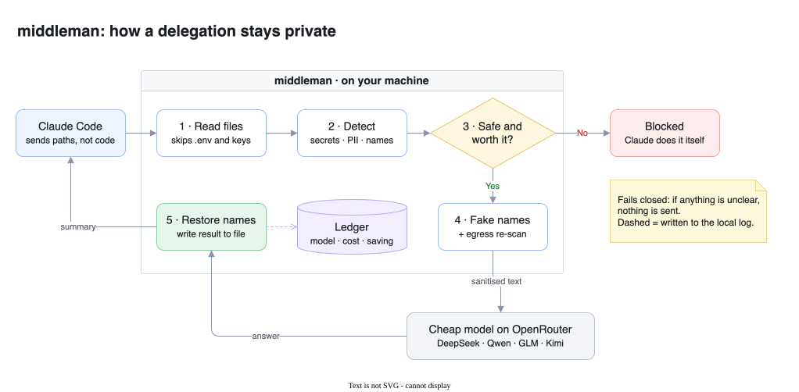

# middleman

[](https://github.com/baturox/middleman/releases/latest)
[](https://github.com/baturox/middleman/actions/workflows/ci.yml)
[](LICENSE)


**Cut your Claude Code bill: let cheap models (DeepSeek, Qwen, Kimi, GLM) do the grunt work, without
them seeing your secrets or knowing whose code it is.**

---

## What is middleman?

Claude is great but expensive. Chinese models on OpenRouter are often **20–250× cheaper** and good at
routine work such as writing tests, boilerplate and docs. Most companies won't send them their code,
though, because they don't know what happens to it.

middleman is a small program that runs **on your machine**, next to Claude Code. It does three things:

1. **📊 Shows where your Claude Code money goes.** It reads Claude Code's local logs and breaks the
   cost down by project, model, session and token type.
2. **🎯 Tells you what to change.** It turns that data into concrete settings with an estimated
   saving for each (for example, "run subagents on Sonnet: saves ~11%").
3. **🛡️ Hands big, boring jobs to cheap models, safely.** When Claude needs, say, a test suite, it
   can pass the job to middleman. middleman removes secrets, replaces your company's names, hosts and
   emails with fake ones, sends the job to a cheap model, puts the real names back, and writes the
   result to a file. Claude then just runs the tests.

The cheap provider only ever sees something like this:

| In your code | What the provider receives |
|---|---|
| `class AcmeInvoice:` | `class ZentroInvoice:` |
| `db.acme-internal.com:5432` | `svc2.example.net:5432` |
| `ali@acme.com` | `user3@example.com` |
| `/Users/ali/acme/src/billing.py` | `/workspace/app/src/billing.py` |
| `AWS_KEY = "AKIA…"` | **nothing: the request is blocked** |

## A real example

> **You:** write unit tests for `src/date_parser.py`

1. middleman's prompt hook sees a big, low-risk job and suggests delegating it.
2. Claude calls `delegate_task` with the file path. It doesn't paste the code, which keeps Claude's
   own token use small.
3. middleman reads the file, cleans it, and sends it to `deepseek/deepseek-v4.1-flash`.
4. The tests come back, the real names are restored, and the result is saved to `tests/test_date_parser.py`.
5. Claude runs the tests and fixes anything that fails.

**Cost:** about **$0.003** with DeepSeek, against about **$0.04** if Claude (Opus) wrote the same
~2,000 tokens itself. The saving is logged, so you can check it later with `middleman report`.

If you ask for anything touching **auth, billing, customer data or secrets**, the hook tells Claude
to **keep it on Claude**, and middleman refuses it if Claude tries anyway.

## How it works

<p align="center">
  
</p>

<sub>Editable source: [`docs/architecture.drawio`](docs/architecture.drawio) (open it in draw.io)</sub>

- **Fails closed.** If anything is unclear (a possible secret, an unknown price, a broken config),
  nothing is sent and Claude does the job itself.
- **Only when it pays off.** Each hand-off costs Claude a little overhead (about 830 output tokens'
  worth on Opus), so small tasks are refused and done by Claude.
- **Your names stay local.** The mapping from fake names back to real ones lives in memory only and
  is never written to disk.
- **Every call is logged**, including blocked ones: model, tokens, cost and net saving.

## Install

**macOS and Linux**, one line:

```sh
curl -fsSL https://raw.githubusercontent.com/baturox/middleman/main/install.sh | sh
```

This downloads the right binary from [Releases](https://github.com/baturox/middleman/releases/latest),
checks its SHA-256 and installs it to `~/.local/bin`.

<details>
<summary>Other options: manual download, Windows, build from source</summary>

| Platform | Release file |
|---|---|
| macOS Apple Silicon | `middleman-<version>-aarch64-apple-darwin.tar.gz` |
| macOS Intel | `middleman-<version>-x86_64-apple-darwin.tar.gz` |
| Linux x86_64 | `middleman-<version>-x86_64-unknown-linux-gnu.tar.gz` |
| Linux ARM64 | `middleman-<version>-aarch64-unknown-linux-gnu.tar.gz` |
| Windows x86_64 | `middleman-<version>-x86_64-pc-windows-msvc.zip` |

```sh
tar -xzf middleman-*-aarch64-apple-darwin.tar.gz
install -m 0755 middleman-*/middleman ~/.local/bin/
xattr -d com.apple.quarantine ~/.local/bin/middleman 2>/dev/null   # macOS: allow the unsigned binary
```

From source (Rust stable):

```sh
cargo install --git https://github.com/baturox/middleman --locked
```

</details>

## Quick start

```sh
middleman init            # pick OpenRouter, log in with your browser (or paste a key), pick scope and mode
middleman setup claude    # shows every change to Claude Code's files, asks, backs them up, applies
```

That's it. Restart Claude Code and the statusline shows `🛡 middleman ✓ openrouter`.

- `init` stores the key in your OS keychain (macOS Keychain, Windows Credential Manager, Linux
  Secret Service). You never type it on the command line, so it isn't in your shell history.
- `setup claude` registers the MCP server, allows its two tools, adds the prompt hook, the
  statusline and the CLAUDE.md block. `--dry-run` only shows the changes; `--undo` puts the old
  files back.
- Later: `middleman models refresh` fetches current prices, `middleman usage` and `middleman tune`
  show where your Claude Code money goes, and `middleman doctor` checks everything.

<details>
<summary>Keys: other providers, rotation, scripts</summary>

```sh
middleman provider add            # pick a provider, paste the key (hidden), it's checked with a free request
middleman provider list           # where each key is stored (never the key)
middleman provider test openrouter
middleman provider rotate openrouter
middleman provider remove deepseek
middleman login openrouter --no-browser   # over SSH: open the link anywhere, paste the code back
pass show openrouter | middleman provider add openrouter --key-stdin   # scripts
```

Environment variables (`OPENROUTER_API_KEY`, ...) still work and win over a stored key. If no
keychain is available (e.g. a headless Linux box), the key goes to a private file
(`~/.config/middleman/keys/<provider>`, mode 0600) and middleman says so.

</details>

## How do I know it's working?

- **Statusline**, at the bottom of Claude Code:
  `🛡 middleman ✓ openrouter · 3 delegated today (1 this session) · saved $0.21 · 1 blocked`.
  It shows `✗` and the reason when the config is broken or no key is found.
- **Hook message**: when you send a prompt, a short line tells you what middleman told Claude,
  e.g. `🛡 middleman: suggested delegating this write_tests task (~3000 output tokens) to a cheap model`
  or `🛡 middleman: keep on Claude (sensitive: billing)`.
- **Tool result**: every `delegate_task` result starts with one line, such as
  `middleman: done via openrouter/deepseek/deepseek-v4.1-flash; wrote tests/test_dates.py (84 lines); cost $0.0028, net saving $0.0216.`
- **`middleman watch`** in another terminal prints each delegation as it happens: time, task,
  model, sensitivity, what was redacted, tokens, cost, net saving, and the reason when blocked.
- **`middleman report`** sums it all up afterwards.

Each log line records the Claude Code session id when it's known. The MCP server gets the id
Claude Code started it with, so after `/clear` its calls still carry the earlier id.

## Saving money: what actually matters

`middleman usage` on 30 days of heavy Claude Code use showed that **about 80% of the bill is Claude
re-reading the conversation on every turn**. Only about 19% is Claude writing code. So the biggest
savings come from settings, and `middleman tune` estimates each one from your own data:

| Change | Typical saving | Data leaves your machine? |
|---|---|---|
| Keep conversations under ~200K tokens (compact earlier, `/clear` between tasks) | ~16% | No |
| Run subagents on Sonnet 5.5 instead of Opus | ~11% | No |
| Use Sonnet 5.5 for routine sessions | ~8% | No |
| Turn off unused plugins and skills (sessions start at ~82K tokens) | ~5% | No |
| Hand big jobs to cheap models via middleman | grows with how much you delegate | Only sanitised text |

`middleman tune` prints the exact `settings.json` change. Run it with `--apply` to merge the change,
after a backup is taken.

> On a Claude **Pro/Max subscription** you don't pay per token, so these savings mean **more usage
> before you hit limits**. On **API billing** they are real dollars. Reports show both.

## Choosing cheap models

Any OpenAI- or Anthropic-compatible provider works; adding one is a few lines of config. With
OpenRouter, one key gives you all the Chinese models:

| Model (OpenRouter ID) | $ / 1M in | $ / 1M out | Good for |
|---|---|---|---|
| `z-ai/glm-5.3-flash` | 0.04 | 0.078 | docstrings, summaries |
| `minimax/minimax-m3.1-flash` | 0.075 | 0.30 | boilerplate, translations |
| `qwen/qwen3.8-flash` | 0.15 | 0.47 | general coding |
| `deepseek/deepseek-v4.1-flash` | 0.30 | 1.20 | unit tests, boilerplate |
| `moonshotai/kimi-k3.1-pro` | 2.00 | 10.00 | harder jobs |
| *for comparison:* Claude Opus 5.5 | 4.00 | 20.00 | |

These are OpenRouter list prices on 2026-11-10. middleman always uses the live prices, and never uses
a model whose price it doesn't know.

`~/.config/middleman/config.toml`:

```toml
[providers.openrouter]
preset = "openrouter"
key_source = "keychain"                    # written by `middleman provider add`; OPENROUTER_API_KEY wins if set
model  = "qwen/qwen3.8-flash"

# Cheapest suitable model first, then DeepSeek, then give the job back to Claude.
[routes.write_tests]
chain = ["auto:code:cheapest", "openrouter/deepseek/deepseek-v4.1-flash", "claude"]

[routing]
mode = "auto"        # auto: Claude delegates when safe · confirm: ask first · explicit: only on "cheap:"
```

> 💡 **Claude Haiku 5.5** ($0.10 / $0.50) costs about the same as these models and is first-party,
> so nothing needs redacting. Use it for anything sensitive that's still routine.

## Commands

| Command | What it does |
|---|---|
| `middleman usage` | Your Claude Code spend from local logs (totals only, never message text) |
| `middleman tune` | Recommended settings, with estimated savings |
| `middleman init` | Guided setup: provider, key (browser login or hidden paste), scope, routing mode |
| `middleman setup claude` | Connect to Claude Code (`--dry-run`, `--undo`, `--scope project`) |
| `middleman provider add/list/test/rotate/remove` | Manage provider keys in the OS keychain |
| `middleman watch` | Live view of delegations in another terminal |
| `middleman report` | What was delegated, to which model, and the net saving (`--html` for a dashboard) |
| `middleman check <files>` | Dry run: shows exactly what *would* be sent, without sending it |
| `middleman route "<prompt>"` | Shows whether a prompt would be delegated, and why |
| `middleman doctor` | Health check: config, keys, keychain, providers, Claude Code wiring |
| `middleman models refresh` | Fetch current models and prices from your providers |
| `middleman completions <shell>` | Shell completions for bash, zsh, fish, elvish, PowerShell |

<details>
<summary><b>Privacy details: what is and isn't hidden</b></summary>

| Risk | What middleman does | What remains |
|---|---|---|
| Secrets in code | Detects keys, tokens, passwords, PEM files, high-entropy strings, card/IBAN/ID numbers, and **blocks** the request | Unusual secret formats |
| Who you are | Replaces your company/product/customer names (from your private list), hosts, emails and paths | Names you didn't add to the list |
| Sensitive files | `.env`, keys, `secrets/`, `.git`, `.ssh` and friends are never read | Add your own folders to the deny list |
| Business logic | Size limits, task-type allow-list, per-provider sensitivity limits | **The code's logic itself can't be hidden.** Only delegate low-value code. |
| Bad answers | Treated as untrusted; warns on new URLs, packages and install commands; never executed | Claude must still review and test |
| Account, IP, timing | Not hidden | Use a separate account or network if this matters |

Resellers and gateways count as untrusted, even when they serve a model called "Claude". Every provider
except first-party Anthropic gets the full treatment.

</details>

<details>
<summary><b>Usage log format</b></summary>

Every attempt, including blocked ones, is one JSON line in `~/.local/state/middleman/ledger.jsonl` (mode 0600):

```json
{"task_kind":"write_tests","provider":"openrouter","model":"deepseek/deepseek-v4.1-flash",
 "effective_sensitivity":"S1","status":"ok","redactions":{"dictionary":5,"email":1},
 "input_tokens":1240,"output_tokens":2050,"cost_usd":0.0028,"latency_ms":6100,
 "write_mode":"file","claude_model":"opus-5.5","claude_equiv_usd":0.041,
 "claude_overhead_usd":0.0166,"net_savings_usd":0.0216,"validation":"passed"}
```

The record also stores the cleaned text exactly as it was sent, so you can audit what left your machine.

</details>

<details>
<summary><b>Configuration reference</b></summary>

See [`config/middleman.example.toml`](config/middleman.example.toml) for every option.

- **Providers:** `preset` fills in the URL, key variable and trust level. Each provider's trust level
  (`untrusted`, `zdr`, `local`, `first_party`) caps how sensitive a job it can receive.
- **Keys** come from an environment variable, the OS keychain (`key_source = "keychain"`), a
  private file (`key_source = "file"`) or a `key_file`, in that order. They're never written into
  the config, logs, the usage log or output, and are wiped from memory after use.
- **Routes:** each task type has a chain of steps. A step is `auto:<code|chat>:<cheapest|balanced|best>`,
  `<provider>/<model>`, or `claude` (give the job back).
- **Budget:** per-call, daily and weekly caps, plus a minimum balance to keep. If the balance can't be
  read, the request is refused.
- **Per-project rules:** a `.middleman.toml` in a repo can only make the rules **stricter**.

The prompt hook (local, ~20 ms, never blocks your prompt) is added by `middleman setup claude`.
It's a `UserPromptSubmit` command hook running `middleman route --hook`.

</details>

## Roadmap

- [x] Safe delegation with reversible fake names
- [x] Any provider through config, live prices, fallback chains
- [x] Usage analysis, `tune` recommendations, savings reports
- [ ] Local proxy for live per-request logs and budget alerts
- [ ] Check that generated code compiles before accepting it
- [ ] Multi-step jobs (a whole sub-agent) on cheap models

## Contributing

Issues and PRs are welcome. Before opening a PR, run:

```sh
cargo fmt --check && cargo clippy --all-targets --locked -- -D warnings && cargo test --locked
```

Design notes are in [`PLAN.md`](PLAN.md).

## License

[MIT](LICENSE)
